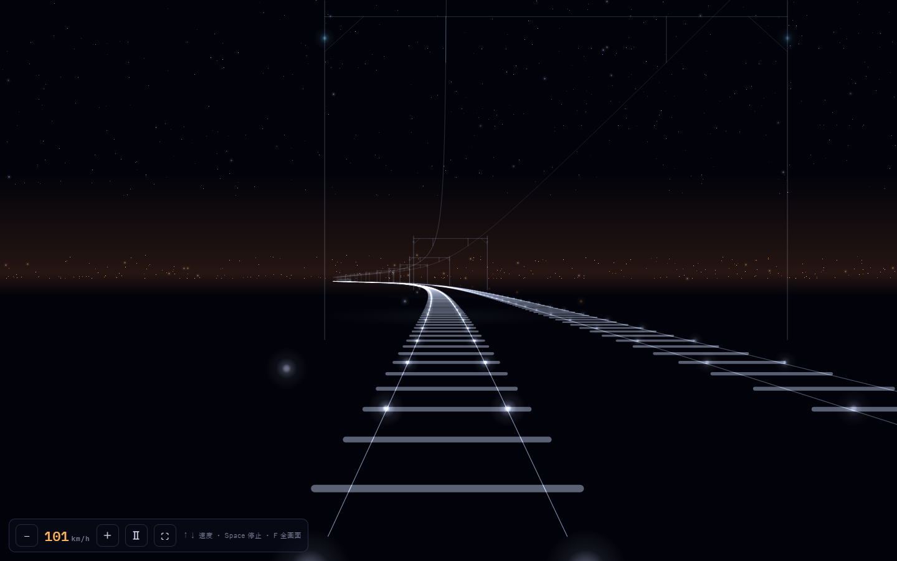

# Night Railway

光の点だけで、夜間の鉄道前面展望を描くシングルページのCanvasアニメーションです。



## Demo

GitHub Pages: <https://sylphjp.github.io/NightRailway/>

`index.html`をMicrosoft Edge、Google Chrome、Firefoxなどのブラウザーで直接開いても動作します。ビルドや追加ライブラリは不要です。

## Features

- 1067 mm軌間の複線
- 門型架線柱と、吊架線・ハンガー・左右偏位を備えたシンプルカテナリ架線
- G現示を基本とし、たまにYG現示になる四灯式信号機
- 3灯の前照灯と、最後尾の赤色尾灯を備えた対向列車
- 上下線の両側に現れる駅ホーム
- 星空、遠くの街明かり、流れ星などの夜景
- 0 km/hまでの速度変更、一時停止、全画面表示

## Controls

| キー | 動作 |
| --- | --- |
| `↑` / `↓` | 加速 / 減速（0 km/hまで） |
| `Space` | 一時停止 / 再開 |
| `F` | 全画面表示 / 解除 |

画面左下のボタンでも操作できます。

## Windowsスクリーンセーバー

### 必要環境

- Windows 10またはWindows 11
- Microsoft Edge
- .NET Framework 4.x（通常はWindowsに含まれています）

### 配布ファイル

リポジトリを[ZIPでダウンロード](https://github.com/sylphjp/NightRailway/archive/refs/heads/master.zip)し、展開してください。スクリーンセーバーの実行に必要なファイルは次のとおりです。

| ファイル | 用途 |
| --- | --- |
| `NightRailway.scr` | Windowsスクリーンセーバー本体 |
| `index.html` | スクリーンセーバーが表示するアニメーション |
| `install.ps1` | ユーザー単位のインストールスクリプト |
| `LICENSE` | MITライセンスと著作権表示 |

`NightRailway.scr`と`index.html`は必ず同じフォルダーに置いてください。`.scr`だけでは動作しません。

### インストール

展開したフォルダーでPowerShellを開き、次を実行します。管理者権限は不要です。

```powershell
powershell.exe -NoProfile -ExecutionPolicy Bypass -File .\install.ps1
```

既定では、10分間操作がないとスクリーンセーバーが起動します。例えば5分にする場合は次のように指定します。

```powershell
powershell.exe -NoProfile -ExecutionPolicy Bypass -File .\install.ps1 -TimeoutSeconds 300
```

インストーラーは必要なファイルを`%LOCALAPPDATA%\NightRailwayScreensaver`へコピーし、現在のWindowsユーザーのスクリーンセーバーとして登録します。設定後は、Windowsの「スクリーン セーバーの設定」で待ち時間などを変更できます。

インストール前に試す場合は、`NightRailway.scr`をダブルクリックしてください。キー入力またはマウス操作で終了します。

新しい版へ更新するときは、最新版のZIPを展開し、`install.ps1`をもう一度実行してください。

> [!NOTE]
> 配布中の`.scr`はコード署名されていません。Windows SmartScreenなどの警告が表示される場合があります。

### ソースからビルド

完成済みの`NightRailway.scr`を同梱しているため、通常はビルド不要です。自分で再ビルドする場合は、次を実行します。

```powershell
powershell.exe -NoProfile -ExecutionPolicy Bypass -File .\build.ps1
```

ランチャーのソースは`NightRailwayScreensaver.cs`です。追加ライブラリは使用していません。

## Run locally

このリポジトリをダウンロードまたはcloneし、`index.html`をブラウザーで開いてください。ローカルHTTPサーバーを使う場合は、リポジトリのルートをそのまま公開ディレクトリにできます。

## Credits

この作品は、Masayuki Hatta様による[Original Night Freeway](https://github.com/mhatta/nightfreeway)を基に、鉄道専用の描画へ変更した派生作品です。

Original Night Freeway was inspired by the original FreeWay screensaver by FKS and the Windows port by Yoshihiro Sugahara.

## License

MIT Licenseです。元作品の著作権表示とライセンスを含む全文は[LICENSE](LICENSE)を参照してください。
